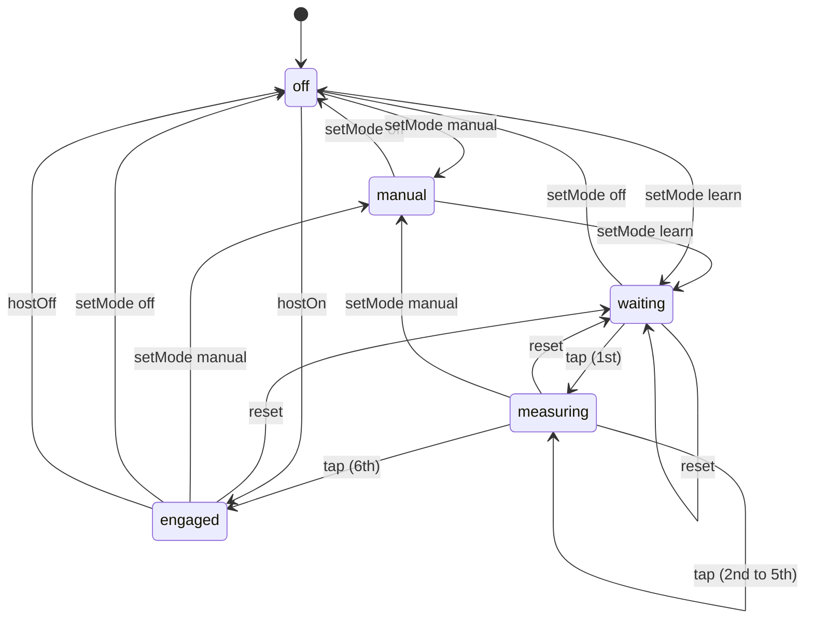

# DESIGN.md

> Visual direction for Prakaram. Read before changing any color, type, or chunk styling.

---

## 1. Direction

Prakaram is a chanting tool, not a temple. It should feel like a printed page on good paper, with the text doing all the work.

**We do not use:** saffron, maroon, temple gold, lotus or om ornaments, mandala backgrounds, gradients and glows outside the exceptions in §7b (the flame, switch fills and active words), drop shadows on text, card borders around verses, or the serif-and-gold "devotional" look that most sites in this space share.

**We do use:** one ink color, one accent tint, generous space, opacity as the only hierarchy for lines, and type that is sharp at small sizes.

---

## 2. Principles

1. **Three lines are the focus.** The active chunk is bold and fully opaque. The line before and after it are at 60%. Every other chunk is at 35%. No box, no background, no border, no scale, no glow around the active line.
2. **Opacity is the hierarchy, with one exception.** Lines recede by opacity: the neighbours of the active line at 60%, the rest at 35%. The active line is also set in semibold (600). Do not use size, colour or boxes to mark the current line.
3. **One accent.** Slate blue ink (`#2f5f7a`) is used for active controls, focus, and the prakara title. Colour is reserved for the line-kind and swara tokens in §3 and §5c. Mantra text is plain ink.
4. **Tints, not fills.** Surfaces are paper neutrals. Where a fill is needed (a pressed pill), use a tint at most one step off the paper.
5. **No decoration.** No gradients or glows outside the §7b exceptions, no blur except zen-mode dimming, no emoji in primary chrome.
6. **Motion is opacity only.** Transitions are 300–350 ms opacity fades. No scale, no slide.

---

## 3. Color Tokens

Defined on `:root` / `[data-theme="light"]` (light base) and `[data-theme="dark"]` in `src/styles/tokens.css`. Theme choice is **System** (default; follows the OS), **Light**, or **Dark**. System removes the `data-theme` attribute so `prefers-color-scheme` decides.

| Token | Value | Use |
| :--- | :--- | :--- |
| `--bg-base` | `#f7f7f5` | Page paper (light) |
| `--bg-card` | `#eeeeeb` | Pressed or hovered neutral |
| `--scrim` | `rgba(247,247,245,.5)` | Half-strength cover behind drop panels |
| `--text-primary` | `#161614` | Active line, headings |
| `--text-secondary` | `#55554f` | Controls, inactive text |
| `--text-muted` | `#8c8c85` | Captions, subtitles |
| `--accent` | `#2f5f7a` (dark `#9ccbe8`) | Active control, focus, prakara title |
| `--spectrum` | pale gold, soft orange, pale blue | Fill of an on switch |
| `--spectrum-ink` | deeper gold, orange, blue (dark: pale) | Active segment and primary text buttons (gradient text) |
| `--swara-up` | `#6d28d9` (dark `#c084fc`) | Svarita, U+0951 (up): purple |
| `--swara-down` | `#1d4ed8` (dark `#60a5fa`) | Anudatta, U+0952 (down): blue |
| `--swara-double` | `#b91c1c` (dark `#f05252`) | Dirgha svarita, U+1CDA (double up): red |
| `--shloka` | `#3d7a55` | Shloka lines (green tint) |
| `--vakya` | `#6e6c85` | Vakya lines (purplish grey) |
| `--flame-core/mid/tip` | blue, yellow, orange | Glow for active icons and choices (`--flame`) |
| `--locate` | `#16a34a` (dark `#4ade80`) | Back-to-line arrow and its glow. The only green in the UI |
| `--accent-light` | `#e8f0f6` | Selected-state tint |
| `--accent-gold` | `#a9cbe0` | Pulse hint for auto-progress (a tint, not gold) |

Dark uses the same rules on a near-black paper (`#121413`), with the accent lifted to `#9ccbe8` for contrast. Text on accent fills uses `--on-accent` (white in light, near-black in dark), never a hardcoded white.

Do not add new hues. If a new state needs color, derive it from `--accent` at lower opacity.

---

## 4. Type

| Role | Face | Notes |
| :--- | :--- | :--- |
| UI and titles | Geist (400, 500, 600) | Titles at 600, tracking `-0.01em`. Uppercase only for small kind labels (Shloka, Vakya) and section captions. |
| Devanagari | Noto Sans Devanagari | Sans only. Serif Indic faces are not used. |
| Telugu, Kannada, Tamil, Malayalam | Noto Sans (matching script) | Same rules as Devanagari. |

**Font features.** Apply globally: `"kern"`, `"liga"`, `"calt"`. Indic text additionally uses `"mark"` and `"mkmk"` for correct combining marks (see `AGENTS.md` §3B for Tamil cluster order). Numeric readouts (BPM, confidence) should use `font-variant-numeric: tabular-nums` so they don't jitter while changing.

**Scale.** Verse text is user-controlled (A-/A+). Labels are 0.75–0.8 rem. Do not introduce a new size without need.

---

## 5. Chunk States

| State | Opacity | Container | Transform |
| :--- | :--- | :--- | :--- |
| Active | 1 | none | none |
| Inactive | 0.35 | none | none |
| Inactive, hovered | 0.6 | none | none |
| Neighbour of the active line (line before or after) | 0.6, active line set in semibold (600) | none | none |
| Zen, inactive | 0.18 + 0.4 px blur | none | none |

The instruction label ("Vakya / Procedure") is an uppercase accent label above the text. It has no fill.

**Rule: one line is always highlighted.** The reader never shows zero active lines. Every render, screenshot and capture must include the highlighted line on screen. If it has scrolled away, scroll back to it before capturing.

**Back to line.** When the highlighted line is entirely off screen, a button appears at the bottom right. It points up or down, toward the line. Tapping it scrolls the line to the centre. It is a green arrow with a green glow (`--locate`, `--locate-glow`) and no fill or border. It is hidden in zen and keeps its opacity transition, so nothing shifts.

---

## 5a. Reading Layout

The reader is a page, not a set of cards.

- Verse lines have 0.2 rem padding and 0.45 rem between lines. Do not add card padding or large gaps.
- Verse text line-height is 1.85.
- **Wrap** (on by default) wraps long lines. Off, each line stays on one row and scrolls sideways.
- **Split** (off by default) divides each verse at danda (`।`, `॥`), then breaks any phrase longer than 1.5× the median phrase length at the word nearest the median. The split happens in the data layer, so the active line, tap cadence, and auto-progress all agree with what is on screen.
- The instruction label appears on the first phrase of an instruction only.

## 5e. Header, Title and Flyouts

- The header is one vertically centred row: a flame mark, the prakara title, and four icons (settings, Koshah, live room, zen). The cadence strip sits directly under it (36px), and the header and strip are one sticky block. Lines scrolling under the block fade out over 20px in the page colour (`.chrome::after`), so they follow the theme. There is no site name in the header.
- The flame mark is Phosphor's flame outline with an amber-to-red gradient (the same everywhere); the favicon and PWA icons add a static glow. On screen its glow, sway and squash follow a random walk (`src/components/FlameMark.tsx`): each channel eases toward random targets at random intervals, so it never settles into a loop (off under reduced motion). The favicon and PWA icons are static, with a fixed glow. The sources are `src/components/FlameMark.tsx` and `public/favicon.svg`; `public/icons/*.png` are rendered from the SVG. `public/icons/icon-monochrome-512.png` is the manifest's monochrome icon (`purpose: monochrome`), for Android themed icons.
- The prakara title sits beside the flame at the left of the header. It wraps to two lines and is limited to the akshara count of the longest default title, so it never widens the header. Tapping it opens the details flyout.
- The details flyout shows the Sanskrit title with its English note, the creator, the line count, the description, and the contents.
- Settings, details and cadence use the same drop panel. Only one is open at a time. Both are opaque, with no border or shadow, and the content behind them sits under `--scrim`.
- The right end of the cadence strip holds the progress indicator. While learning it shows seconds and the `n/6` count. In Auto with a fixed or learned pace it shows the minimap (§5b Minimap). It is hidden in Off, but keeps its space.
- The title is never clipped. A long word that does not fit wraps by character, and the header grows to fit it.

## 5c. Line Kinds

| Kind | Looks like | Source |
| :--- | :--- | :--- |
| Mantra | Primary ink, regular weight. A swara syllable takes its direct colour: up purple, down blue, double up red | Sukta line. Colour is per syllable, so conjuncts stay whole |
| Shloka | Green tint `--shloka`, medium weight, small "Shloka" label | Custom verse ending in `॥` |
| Vakya | Purplish grey `--vakya`, italic, small "Vakya" label | Other procedural text |

The swara and line-kind colours are provisional. Other kinds may get colours later; add them here first.

Only the first phrase of a split line carries the label.

## 5b. Cadence

Cadence has a strip under the header, always visible, and a pace panel. The strip holds an **Auto** switch, a **Learn** toggle that appears only while Auto is on, a readout, and the progress indicator. Learn is a phase of Auto, not a separate mode: Auto on with Learn off is Manual, Auto on with Learn on is Learn. With Auto off the strip is just the switch. Tapping the readout opens the pace panel, which holds the pace slider, Next or Tap, Share and Reset. Only one drop panel is open at a time. The strip hides in zen, and keeps its space.

The cadence state machine lives in `src/services/cadenceMachine.ts` as a pure `transition(state, event)` function. The store in `src/stores/useCadenceStore.ts` is the only place a phase changes, through `send`. Components read the phase and never set it.

### Modes

There is one pace, in milliseconds per mātrā. Every mode uses it.

| Mode | What it does | Pace slider | Next or Tap | Progress indicator |
| :--- | :--- | :--- | :--- | :--- |
| **Off** (default) | No auto-advance. You move the lines. | Pale and disabled | Next | Hidden |
| **Manual** | Lines advance on their own at the set pace. | Live, sets the pace | Next. Restarts the countdown | Minimap, with pause |
| **Learn** | Taps teach the pace. After six lines, lines advance at the learned pace. | Live afterwards, adjusts the learned pace | Tap while learning, then Next | Seconds and count while learning; minimap once learned |

### States

| Phase | Mode | Meaning | Header | Next / Tap | Reader |
| :--- | :--- | :--- | :--- | :--- | :--- |
| `off` | Off | No auto-advance | Hidden (space kept) | "Next" | Normal scroll |
| `manual` | Manual | Auto-advance at the set pace | Minimap, with pause | "Next" | Normal scroll, lines advance |
| `waiting` | Learn | No tap yet this run, or a reload happened mid-run | `0 s`, `0/6`, pulsing dot | "Tap", pulses | Scroll locked, next line 60% |
| `measuring` | Learn | Taps are counted. The clock runs from the first tap | Seconds ticking, `n/6` | "Tap" | Scroll locked, next line 60% |
| `engaged` | Learn | Six lines learned, lines advance at the learned pace | Minimap, with pause | "Next" | Normal scroll, lines advance |

`LEARN_LINES` is 6. Every tap while learning counts as one learned line. The seconds clock starts on the first tap, not when Learn is chosen. Pause is a flag inside `manual` and `engaged`. It is not saved.

### Events

| Event | Source | Effect |
| :--- | :--- | :--- |
| `setMode` | The Auto switch and Learn toggle | Off, Manual, or a fresh Learn run. Setting the current mode changes nothing |
| `tap` | Tap, Space, or clicking the active or next line | Learning only: counts a learned line; the sixth moves to `engaged` |
| `reset` | Clear recorded taps | Learning phases and `engaged` go back to `waiting` at zero. No-op in `off` and `manual` |
| `togglePause` | Tapping the minimap | Pauses or resumes in `manual` and `engaged` |
| `hostOn` / `hostOff` | Room sync from the host | `engaged` on or off. A follower's mode control is disabled |

### Transitions

Taps in `off`, `manual` and `engaged` are ignored. A reload turns `measuring` back into `waiting` with the count kept, and the clock restarts at the next tap.

### Auto-advance

A line advances on its own in `manual` and `engaged` unless paused. The timer is the line's mātrā weight times the pace. Next, or a click on a line, restarts the countdown for the new line. The pace slider changes the pace at once, so the countdown is never stale.

### Tap target

- While learning, clicking the active line or the next line counts as a tap. Clicking a line further away resets learning to `waiting` at zero, then jumps to it. Outside learning, a click jumps.
- While learning, the page does not scroll and text cannot be selected. The line before and after the active one are drawn at 60% opacity, so the next line reads as the tap target.
- Space does the same as Next, or as a tap while learning.

### Highlights

Learn uses the flame glow on its label when on. It pulses while waiting and measuring, and holds steady once engaged. The pace slider takes the same highlight while learning. Manual has no highlight: it is the plain setting.

### Minimap

The minimap is a picture of the three lines the reader highlights: the previous line on top, the current line in the middle, the next line at the bottom. It is built by `minimap()` in `src/services/minimap.ts`, which takes the three chunks and returns the rows to draw. `Minimap.tsx` only renders them.

A line that wraps on the page wraps in the minimap too. The reader's wrapped lines are measured from the page (`measureLines()` in `src/services/lineBreaks.ts` counts the characters on each screen line, re-measured when the active line, font size, script or window width changes), and `minimap()` splits each line's syllables across those screen lines in proportion. Screen lines of one chunk sit close together (0.03 rem); chunks are further apart (0.1 rem).

Each screen line is a run of thin boxes (0.16 rem wide, 0.14 rem tall), one per syllable, with a half-width blank where there is a word gap. Boxes touch with no spacing, so a line reads as one continuous strip. The corners are square, not rounded. The longest screen line of the three is shrunk to at most 20 boxes, and every other line uses the same ratio (several syllables share a box on long lines). Lines are left aligned. At the first or last line the missing neighbour is empty. When the active line changes the rows scroll: the minimap holds two chunks before and two after the current one, slides them up so the new current row is centred (0.45 s, the same ease-out as the page), fades the old previous row out and the new next row in, and the top and bottom edges fade. Rows keep their DOM node, so nothing redraws.

Boxes take the colour of the line's text: `--text-primary` for mantra, `--shloka` for shloka, `--vakya` for vakya (the same classes the reader uses). A box that holds a swara mark takes `--swara-up`, `--swara-down` or `--swara-double`, as the reader does. Neighbours are very faint (18%). The current line is drawn once, and a CSS mask (an animated `--sung` percentage) sweeps left to right over the time that line has, along the first screen line and then the next: boxes already sung are full strength, the pending rest 22%. It restarts for the next line. Tapping the minimap pauses: the rows shrink to 70% and fade, and a pause mark appears over them. The mark is `--text-primary` with a `--bg-base` outline, so it reads on light and dark. Tapping again resumes with the time that was left. Jumping to another line while paused restarts that line at full time when you resume. The minimap is 3.2 × 1.9 rem and the strip keeps its height.

### Hold and away

- **Hold** (touch the active line). Pauses auto-advance at once, and releasing resumes with the time that was left. It is a relearn signal: the time held stays in the line's reading time, so a long hold teaches the learner that the line is slower. In Manual and once learned, the touch does not advance the line. In Learn, a tap on the active line still counts as a learning tap.
- **Pause** (the minimap). A deliberate pause, to come back to later. It stops the line clock, so the time paused adds nothing to learning.
- **Away.** When the tab is hidden or the window loses focus, auto-advance and the line clock stop, and resume on return. This is the "Pause when away" setting, on by default.

**Learning samples.** While Learn is active (learning, or learned), each line's active time is a sample: the time it was on screen, excluding pauses and away time, including holds. Every advance of one line gives a sample: a learning tap, a timer advance, Next, or a click on the next line. A jump of more than one line gives none. Guests give none.
- Holding and away are not saved.

**Shared sessions.** A host's lines and timing are followed by guests. A guest has no local cadence control: taps, Next, arrow and Space keys, line clicks, the minimap, the pace slider, the Auto switch and the Learn toggle are disabled, and away-pause does not apply. A guest can leave the room to use the app alone.

### Pace

One slider, in milliseconds per mātrā, from 50 to 3000, default 833. The scale is logarithmic: equal moves of the slider multiply the pace by the same factor, so the slow and fast ends get as much room as the middle. Moving right is faster (a shorter pace), so the left end is the slowest. Longer lines take longer. Learning writes the learned pace into the same value, so the slider always shows the pace in use. There are no presets.

**Disabled.** A disabled control is drawn at 30% opacity and does not respond. The pace slider is disabled in Off. The Auto switch and Learn toggle are disabled for a room follower, whose host controls cadence.

**Default.** Auto is off on a first run (`INITIAL_LEARNING` is `off`). Saved settings are kept as they were.

**Persistence.** The mode, the learned line count and the pace are saved. Pause and the learning clock are not. There are no users yet, so saved state is not migrated; a change to the saved shape may reset it.

## 5d. Zen

Zen shows only the content and the zen (lotus) button. Everything else in the header is hidden, not removed:

- Hidden items keep their boxes, so nothing moves. Hiding uses opacity and visibility, never `display` and never a transform.
- The header fill is dropped in zen, so the lotus floats over the text.
- Any open drop panel closes when zen turns on.
- The lotus is the only way to leave zen, along with the Z key. There is no separate exit hint.

## 5f. Koshah

The Koshah is the library: every piece of text the app holds, presented as a wiki. Its pages replace the player while the address is a `#/wiki` route. The player header's Koshah icon opens the main page. Wiki pages have the player's header, tokens and gutters: `WikiTopBar` (`src/components/Header.tsx`) holds the flame (to the main page), the search box with suggestions, then settings, Koshah, live room and player icons, with a **My prakaram (n)** link under it. Settings open the same drop panel as in the player. Old `#k=<id>` and `#k=<id>/<n>` links are redirected to the article address.

### Routes

| Address | Page |
| :--- | :--- |
| `#/wiki` | Main page: featured article, recent articles, counts by Veda and deity |
| `#/wiki/<id>` | Article for one document, e.g. `#/wiki/rudram-namakam` |
| `#/wiki/<id>/<n>` | The same article, scrolled to section `n` |
| `#/wiki/<id>/<s>.<from>-<to>` | Scrolled to the lines, whose numbers take the accent colour (also `<s>.<l>` and `<s1>.<l1>-<s2>.<l2>`; a nirdeśa, AGENTS.md §1b) |
| `#/wiki/Category:<name>` | Articles in one category |
| `#/wiki/Special:Search?q=<text>` | Search results |
| `#/wiki/Special:Random` | A random article; the app redirects to it (reached by address only, no link) |
| `#/wiki/Special:Compose` | My prakaram: the basket, ordered and named (see My prakaram) |

Ids, category names and search text are URL-encoded. Anything outside `#/wiki` is the player. `#compose` opens the prakara composer in the player.

`parseRoute()` and the address builders (`articleHash()`, `categoryHash()`, `searchHash()`, `COMPOSE_HASH`) and `legacyHash()` live in `src/services/wikiNav.ts`. Article and category data come from `src/services/wiki.ts`, derived from `src/data` on each render.

### Pieces

A piece is one thing that can be read or run. Pieces are derived from the documents in `src/data` by `listPieces()` in `src/services/koshah.ts`. They are never stored, so a piece cannot drift from the text it came from.

| Document | Pieces |
| :--- | :--- |
| One section | One piece: the whole sukta |
| Several sections (anuvakas) | One piece for the whole sukta, and one piece for each section |

| Piece | `id` | Kind | Title |
| :--- | :--- | :--- | :--- |
| Whole sukta | `<documentId>`, e.g. `rudram-namakam` | `sukta` | The document title |
| One section | `<documentId>/<sectionNumber>`, e.g. `rudram-namakam/3` (a nirdeśa; so are line ranges) | `anuvaka` | The document title, then the section title in English |

Each section heading in an article follows that section's piece (its sectionId is kept). The play button beside the title follows the whole document. Following makes the piece the active prakara, then leaves the wiki for the player. Nothing is added to the saved prakaras.

### Sources and compositions

A **source** article owns text. Its sections are its addressable parts: `docId/n` is one part; a line range is addressed with a nirdeśa (`docId/n.a-b`), not a part. A **composition** article (`metadata.kind: "composition"`) owns no text; `metadata.parts` lists `{ article, section?, note? }` references to parts of sources, in order. The default prakaras in `src/data/defaultPrakaras.ts` appear as compositions, derived by `prakaraAsDoc()`: their sukta items become parts, their procedural vakyas are left out.

A composition page shows the referenced text inline, each part headed "from <source> §n" with a link back, then **Brings** (inherited from its parts). The play button beside the title (**Follow this composition**) runs it. A source page lists its sections, each with [follow] and, when the article has more than one section, Add to my prakaram, and, in Info, **Used in**: the compositions that reference any of its parts, computed. Missing ids and cycles are skipped. The main page has Browse by kind (Sources, Compositions).

### Media

An article brings media: text, transliteration, translation, audio, commentary, image. Text (Devanagari, with swara when the lines carry the marks), transliteration (IAST, Telugu, Kannada, Malayalam, Tamil) and English translation (when lines have `translation`) are derived. Anything else is declared in `metadata.media`. A composition inherits the media of its parts. The page lists them under **Brings**, a plain list after the text: kind, language, script, swara, count, source. Search matches the kind words. The player plays text only for now: other media are listed, not played.

### Article anatomy

An article is a page of text with no boxes, borders, rules or tints. Space and type scale do the separating (§7b). Top to bottom:

1. **Breadcrumb.** One muted line of plain links: `Koshah › <Veda, or Sources / Compositions> › <title>`. The title, in the chosen script, is the current page and not a link. It wraps on small screens. There is no tab row.
2. **Title.** A compact h1 (1.35rem), the Sanskrit in the chosen script, with the English name beneath as one muted line. At the end of the title's first line sits a **Follow** button: the Phosphor regular `play` icon in an `icon-btn` hit area, no fill or box, accent on hover and press. Its label (`aria-label` and `title`) is "Follow", or "Follow this composition". It opens the player on the article.
3. **Info.** One native `
`/`
`, closed by default, no box, border or tint. The summary reads `Info` with a muted peek (`Yajurveda · Rudra · 214 lines`) and a rotating caret; when the status is `draft` or the licence says "not yet confirmed" the accent word `Draft` ends the peek, so the notice is found without opening it. Inside: the notice ("Draft." in accent), the lead `summary`, the facts as a plain definition list (Veda, Deity, Usage, Source, Status, Licence, Lines; Status is a coloured word, Licence reads "Not stated" when empty), **Brings**, **Used in**, **Related articles**, Categories, and the links **Add to my prakaram** (the whole article), Edit and View history (GitHub).
4. **Sections.** The media. Each line of a source has a **gutter number**: a muted 0.7rem numeral, the line's number inside its section, no box. Tap one to start, tap another to end a range (a third tap starts over; tapping the same number twice clears). Picked numbers take the accent colour and bold, with no background tint. Under the last picked line one quiet text row reads `Follow lines 3–9`, `Add to my prakaram`, `Copy link`, `clear` (`Follow §3.2–§4.5` across sections). Compositions show no gutter. Typing a nirdeśa such as `rudram-namakam/3.2-3.9` in the search box opens it. Heading `n. title` with space above, and small muted text links **[follow]** (runs that section), Add to my prakaram and **[edit]**. The verse lines follow, with swara colours as in §5c. A `#/wiki/<id>/<n>` address scrolls to the section heading, which keeps a `scroll-margin-top` clear of the header.
5. **Contents.** A source with two or more sections shows a small muted text button `Contents` in the title row, before the play button (accent on hover and while open; hidden for single-section sources and compositions). It opens a fade-in, opaque `--bg-base` surface over the text (no border, shadow or tint; closes on outside tap, Escape or choosing a row; focus moves into the list and returns to the button on Escape). Each row is plain text: the number, the section title and its muted **pratīka** (the first words of its first line, about four words or 28 aksharas with an ellipsis, skipping a line that is only ॐ, through the Sanskrit renderer), then small links **Follow** and **Add to my prakaram**. The row text jumps to the section. Sections are always shown in full below: nothing collapses. The intro itself carries no Parts list.

The main page, search and category pages follow the same rule: large welcome line, counts as plain figures, stacked text entries, matches in accent colour (no `<mark>` fill). The wiki search field has no border or underline; it is a caret and muted placeholder, with the focus ring on `:focus-visible` only. Its suggestion list is an opaque `--bg-base` surface with no border or shadow.

The text shown is the text the player runs. A missing article id shows "This article does not exist yet" and a link to create it on GitHub.

### My prakaram

Add to my prakaram (on an article, or on a section) puts a piece in the basket, `useBasketStore` (`src/stores/useBasketStore.ts`, persisted as `prakaram-basket`; ids that no longer exist are dropped on load). The toggle then reads "Added ✓ · remove". `#/wiki/Special:Compose` lists the basket with each piece's line count and media, lets you move a piece up or down or remove it, name the result, and then **Follow now** (saves it as a prakara and opens the player) or **Save to my prakarams** (saves it and stays). `basketToPrakara()` in `src/services/basket.ts` builds the prakara: one `sukta_ref` per piece, and a section or range item keeps its `nirdesa`, so it runs those lines only. An empty basket shows three steps. A basket item is a nirdeśa: a whole text, a section or a line range (Compose lists a range as `<title> · §3 lines 3–9 · 7 lines`), and the prakara step keeps it in `PrakaraItem.nirdesa`, so the player runs only those lines. Limits: the player plays text only, and Follow on a composition saves it as a new prakara each time. Reordering is by up and down buttons, not drag.

### Editing

The wiki has no editor. Every article is a file in git, so changes are made the same way as code:

- **Edit** and **[edit]** open the document's file, `src/data/<file>.json`, in GitHub's editor.
- **View history** opens the file's commit list on GitHub.
- A change is a commit on a branch and a pull request into `main`. The wiki updates when the change is deployed. The steps are in MAINTAINERS.md §4a.

### Metadata

Each document's `metadata` feeds the wiki. The type is `MantraDocument` in `src/types/mantra.ts`.

| Field | Use |
| :--- | :--- |
| `veda` | `rigveda`, `yajurveda`, `samaveda`, `atharvaveda` or `other`. Info Veda, and the Veda counts on the main page |
| `vedaNote` | The older free-text Veda note, e.g. "Krishna Yajurveda, Taittiriya Samhita 4.5". Kept in the data; the wiki does not show it, and `veda` is what it uses |
| `deity` | The deity in plain English. Info Deity, the deity counts on the main page, and search |
| `categories` | Category names, e.g. `Suktas`, `Rudram`, `Devi`. Category pages, the footer and search |
| `summary` | Two or three sentences, like a Wikipedia lead. The lead, and search |
| `related` | Ids of other documents. Related articles, in the order given |
| `usage` | When the text is chanted. Info Usage |
| `kind` | `source` (default) or `composition` |
| `parts` | For a composition: `{ article, section?, note? }` references, in order |
| `media` | Declared media beyond the derived ones: `kind`, `label`, `language`, `script`, `swara`, `source`, `license`, `url` |
| `source` | Where the text comes from. Info Source |
| `status` | See Status below |
| `license` | Licence or permission note. Info Licence |

Search ranks a title match first (3), then a category or deity match (2), then a summary match (1), then a section title or source match (0.5). Media kind words count as a category match. It ignores case and Latin diacritics, so "Sri" finds "Śrī". Ties keep document order.

### Status

Status is set per document in `metadata.status`. A missing status is `draft`.

| Status | Meaning |
| :--- | :--- |
| `draft` | Not yet checked against a printed edition. The default. |
| `proofread` | Checked against a printed edition. Not yet checked a second time. |
| `reviewed` | Proofread, then checked a second time. |

### Source and licence

- Every document gives `metadata.source`, and every article shows it.
- Every document gives `metadata.license` where it is known, and every article shows it. An article with no licence note shows "Not stated".
- Text with unconfirmed permission stays `draft`, even when it has been proofread. The notice under the title says so.
- Articles come only from the corpus in `src/data`.

## 6. Translations

Translation lines are not shown under mantras. Do not reintroduce them as a default. The data stays in the corpus for future use.

---

## 7. Mobile

- Page gutter is 16 px.
- Header is one row, vertically centred: flame and prakara title on the left, four borderless icon buttons on the right (settings, Koshah, room, zen). Active icons take the accent colour and the flame glow on the glyph, not a tint.
- Settings (script, text size, wrap, split, theme) drop down from behind the header on every screen size. Do not add settings to the header.
- Cadence controls are a drop panel from the header, not a floating bar. Nothing is hidden off-screen.
- Touch targets are 40 px on every screen. Icon buttons keep 40 px on phones too (the header row fits at 412 px). Do not shrink text targets.

---

## 7b. Surfaces, Borders and Buttons

Exceptions: the switch is the one rounded control (a pill track with a round knob). Its on-state, and the active segment and primary text buttons, use the orange-yellow-blue spectrum (`--spectrum`, `--spectrum-ink`).

Text first. The app is words on paper, and controls are words too.

- **No borders by default.** No element gets a border, outline ring or hairline divider unless this document names it as an exception.
- **Exceptions, explicit only:** keyboard focus ring (`:focus-visible`, 1 px accent), the switch track in settings and in the cadence strip, and the back-to-line arrow, which is a green glyph with a green glow and no border. Add any new exception here first.
- **Buttons are text.** A text button is accent-coloured words with no fill. Secondary text buttons are muted. Only icon buttons use a shape, and that shape is only the hit area.
- **Groups are rows of words.** Option choices (System / Light / Dark) are text separated by space, not pills.
- **Active state is colour and glow.** The chosen word or icon takes the accent colour and the flame glow (`--flame`). No background tint, no outline.
- **The glow belongs to the glyph, never the box.** Icon buttons have no fill, tint, hover box or border in any state. The flame filter is applied to the icon's `svg`, so only the drawn shape glows. Never put `filter` on a button or a container.
- **Pressed state is a small scale-down and the flame glow on the icon.** No background change on press.
- **Disabled is the palest version.** A disabled control drops to 30% opacity and takes no input. It keeps its shape and words.
- **Surfaces are fills, not frames.** A panel is an opaque `--bg-base` surface with no border and no shadow. Content behind a flyout sits under the half-strength `--scrim`.
- **Separation is space**, not lines. Use spacing and type scale before adding any rule.
- **The wiki obeys the same rules.** Articles, the main page, search, My prakaram and the wiki bar use text, space and type scale only (§5f).

## 8. Checklist for a Design Change

- [ ] Are there no borders, outlines or pills (except the listed exceptions)?
- [ ] Is every button text, with the active state shown by accent colour and glow?
- [ ] Does the glow sit on the icon glyph (not on a button box), with no fill on any icon-button state?
- [ ] Does the active line still have no container?
- [ ] Are inactive lines still semi-transparent, and the active one fully opaque?
- [ ] Is there still only one accent hue?
- [ ] Are gradients and glows limited to the §7b exceptions, with no ornaments?
- [ ] Do Indic lines still render in sans-serif?
- [ ] Does it pass at 390 px wide with no horizontal page scroll?
