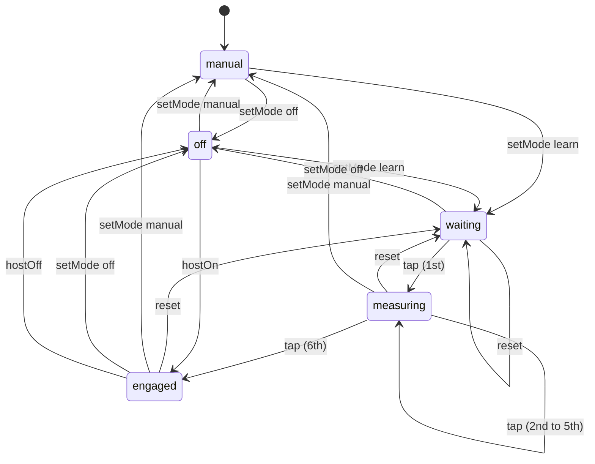

# DESIGN.md

> Visual direction for Parayanam. Read before changing any color, type, or chunk styling.

---

## 1. Direction

Parayanam is a chanting tool, not a temple. It should feel like a printed page on good paper, with the text doing all the work.

**We do not use:** saffron, maroon, temple gold, lotus or om ornaments, mandala backgrounds, gradients, ambient glows (the flame glow is only for active controls), drop shadows on text, card borders around verses, or the serif-and-gold "devotional" look that most sites in this space share.

**We do use:** one ink color, one accent tint, generous space, opacity as the only hierarchy for lines, and type that is sharp at small sizes.

---

## 2. Principles

1. **Three lines are the focus.** The active chunk is bold and fully opaque. The line before and after it are at 60%. Every other chunk is at 35%. No box, no background, no border, no scale, no glow around the active line.
2. **Opacity is the hierarchy, with one exception.** Lines recede by opacity: the neighbours of the active line at 60%, the rest at 35%. The active line is also set in semibold (600). Do not use size, colour or boxes to mark the current line.
3. **One accent.** Teal ink (`#1f5f63`) is used for active controls, focus, and the prakara title. Colour is reserved for the line-kind and swara tokens in §3 and §5c. Mantra text is plain ink.
4. **Tints, not fills.** Surfaces are paper neutrals. Where a fill is needed (a pressed pill), use a tint at most one step off the paper.
5. **No decoration.** No gradients, no glows, no blur except zen-mode dimming, no emoji in primary chrome.
6. **Motion is opacity only.** Transitions are 300–350 ms opacity fades. No scale, no slide.

---

## 3. Color Tokens

Defined on `:root` / `[data-theme="light"]` (light base) and `[data-theme="dark"]` in `src/styles/theme.css`. Theme choice is **System** (default; follows the OS), **Light**, or **Dark**. System removes the `data-theme` attribute so `prefers-color-scheme` decides.

| Token | Value | Use |
| :--- | :--- | :--- |
| `--bg-base` | `#f7f7f5` | Page paper (light) |
| `--bg-card` | `#eeeeeb` | Pressed or hovered neutral |
| `--scrim` | `rgba(247,247,245,.5)` | Half-strength cover behind drop panels |
| `--text-primary` | `#161614` | Active line, headings |
| `--text-secondary` | `#55554f` | Controls, inactive text |
| `--text-muted` | `#8c8c85` | Captions, subtitles |
| `--accent` | `#1f5f63` | Active control, focus, prakara title |
| `--swara-up` | `#6d28d9` (dark `#c084fc`) | Svarita, U+0951 (up): purple |
| `--swara-down` | `#1d4ed8` (dark `#60a5fa`) | Anudatta, U+0952 (down): blue |
| `--swara-double` | `#b91c1c` (dark `#f05252`) | Dirgha svarita, U+1CDA (double up): red |
| `--shloka` | `#3d7a55` | Shloka lines (green tint) |
| `--vakya` | `#6e6c85` | Vakya lines (purplish grey) |
| `--flame-core/mid/tip` | blue, yellow, orange | Glow for active icons and choices (`--flame`) |
| `--locate` | `#16a34a` (dark `#4ade80`) | Back-to-line arrow and its glow. The only green in the UI |
| `--countdown` | `#ca8a04` (dark `#facc15`) | Countdown ring arc, its faint full track, and the pause mark inside it |
| `--accent-light` | `#e6efef` | Selected-state tint |
| `--accent-gold` | `#a9cbc8` | Pulse hint for auto-progress (a tint, not gold) |

Dark uses the same rules on a near-black paper (`#121413`), with the accent lifted to `#7fc4bf` for contrast. Text on accent fills uses `--on-accent` (white in light, near-black in dark), never a hardcoded white.

Do not add new hues. If a new state needs color, derive it from `--accent` at lower opacity.

---

## 4. Type

| Role | Face | Notes |
| :--- | :--- | :--- |
| UI and titles | Geist (400, 500, 600) | Titles at 600, tracking `-0.01em`. Uppercase only for small kind labels (Shloka, Vakya) and section captions. |
| Devanagari | Noto Sans Devanagari | Sans only. Serif Indic faces are not used. |
| Telugu, Kannada, Tamil, Malayalam | Noto Sans (matching script) | Same rules as Devanagari. |

**Font features.** Apply globally: `"kern"`, `"liga"`, `"calt"`. Indic text additionally uses `"mark"` and `"mkmk"` for correct combining marks (see `AGENTS.md` §3B for Tamil cluster order). Numeric readouts (BPM, confidence) should use `font-variant-numeric: tabular-nums` so they don't jitter while changing.

**Scale.** Verse text is user-controlled (A-/A+). Labels are 0.75–0.8 rem. Do not introduce a new size without need.

---

## 5. Chunk States

| State | Opacity | Container | Transform |
| :--- | :--- | :--- | :--- |
| Active | 1 | none | none |
| Inactive | 0.35 | none | none |
| Inactive, hovered | 0.6 | none | none |
| Neighbour of the active line (line before or after) | 0.6, active line set in semibold (600) | none | none |
| Zen, inactive | 0.18 + 0.4 px blur | none | none |

The instruction label ("Vakya / Procedure") is an uppercase teal label above the text. It has no fill.

**Rule: one line is always highlighted.** The reader never shows zero active lines. Every render, screenshot and capture must include the highlighted line on screen. If it has scrolled away, scroll back to it before capturing.

**Back to line.** When the highlighted line is entirely off screen, a button appears at the bottom right. It points up or down, toward the line. Tapping it scrolls the line to the centre. It is a green arrow with a green glow (`--locate`, `--locate-glow`) and no fill or border. It is hidden in zen and keeps its opacity transition, so nothing shifts.

---

## 5a. Reading Layout

The reader is a page, not a set of cards.

- Verse lines have 0.2 rem padding and 0.45 rem between lines. Do not add card padding or large gaps.
- Verse text line-height is 1.85.
- **Wrap** (on by default) wraps long lines. Off, each line stays on one row and scrolls sideways.
- **Split** (off by default) divides each verse at danda (`।`, `॥`), then breaks any phrase longer than 1.5× the median phrase length at the word nearest the median. The split happens in the data layer, so the active line, tap cadence, and auto-progress all agree with what is on screen.
- The instruction label appears on the first phrase of an instruction only.

## 5e. Header, Title and Flyouts

- The header is one vertically centred row: a flame mark, the prakara title, and icons. There is no site name in the header.
- The prakara title sits beside the flame at the left of the header. It wraps to two lines and is limited to the akshara count of the longest default title, so it never widens the header. Tapping it opens the details flyout.
- The details flyout shows the Sanskrit title with its English note, the creator, the line count, the description, and the contents.
- Settings, details and cadence use the same drop panel. Only one is open at a time. Both are opaque, with no border or shadow, and the content behind them sits under `--scrim`.
- The learning indicator sits between the title and the icons. While learning it shows seconds above a hollow ring and the `n/6` count. In Manual and once learned it shows only the countdown ring, which restarts on every line. It is hidden in Off, but keeps its space.
- The title is never clipped. A long word that does not fit wraps by character, and the header grows to fit it.

## 5c. Line Kinds

| Kind | Looks like | Source |
| :--- | :--- | :--- |
| Mantra | Primary ink, regular weight. A swara syllable takes its direct colour: up purple, down blue, double up red | Sukta line. Colour is per syllable, so conjuncts stay whole |
| Shloka | Green tint `--shloka`, medium weight, small "Shloka" label | Custom verse ending in `॥` |
| Vakya | Purplish grey `--vakya`, italic, small "Vakya" label | Other procedural text |

The swara and line-kind colours are provisional. Other kinds may get colours later; add them here first.

Only the first phrase of a split line carries the label.

## 5b. Cadence

Cadence lives in a drop panel opened by the cadence icon in the header. The panel holds three things: the mode, the pace slider, and Next or Tap with Share and Reset. Only one drop panel is open at a time.

The cadence state machine lives in `src/services/cadenceMachine.ts` as a pure `transition(state, event)` function. The store in `src/stores/useCadenceStore.ts` is the only place a phase changes, through `send`. Components read the phase and never set it.

### Modes

There is one pace, in milliseconds per mātrā. Every mode uses it.

| Mode | What it does | Pace slider | Next or Tap | Countdown ring |
| :--- | :--- | :--- | :--- | :--- |
| **Off** | No auto-advance. You move the lines. | Pale and disabled | Next | Hidden |
| **Manual** (default) | Lines advance on their own at the set pace. | Live, sets the pace | Next. Restarts the countdown | Shown, with pause |
| **Learn** | Taps teach the pace. After six lines, lines advance at the learned pace. | Live afterwards, adjusts the learned pace | Tap while learning, then Next | Seconds and count while learning; ring once learned |

### States

| Phase | Mode | Meaning | Header | Next / Tap | Reader |
| :--- | :--- | :--- | :--- | :--- | :--- |
| `off` | Off | No auto-advance | Hidden (space kept) | "Next" | Normal scroll |
| `manual` | Manual | Auto-advance at the set pace | Countdown ring, with pause | "Next" | Normal scroll, lines advance |
| `waiting` | Learn | No tap yet this run, or a reload happened mid-run | `0 s`, `0/6`, pulsing ring | "Tap", pulses | Scroll locked, next line 60% |
| `measuring` | Learn | Taps are counted. The clock runs from the first tap | Seconds ticking, `n/6` | "Tap" | Scroll locked, next line 60% |
| `engaged` | Learn | Six lines learned, lines advance at the learned pace | Countdown ring, with pause | "Next" | Normal scroll, lines advance |

`LEARN_LINES` is 6. Every tap while learning counts as one learned line. The seconds clock starts on the first tap, not when Learn is chosen. Pause is a flag inside `manual` and `engaged`. It is not saved.

### Events

| Event | Source | Effect |
| :--- | :--- | :--- |
| `setMode` | The mode control | Off, Manual, or a fresh Learn run. Setting the current mode changes nothing |
| `tap` | Tap, Space, or clicking the active or next line | Learning only: counts a learned line; the sixth moves to `engaged` |
| `reset` | Clear recorded taps | Learning phases and `engaged` go back to `waiting` at zero. No-op in `off` and `manual` |
| `togglePause` | Tapping the ring | Pauses or resumes in `manual` and `engaged` |
| `hostOn` / `hostOff` | Room sync from the host | `engaged` on or off. A follower's mode control is disabled |

### Transitions

Taps in `off`, `manual` and `engaged` are ignored. A reload turns `measuring` back into `waiting` with the count kept, and the clock restarts at the next tap.

### Auto-advance

A line advances on its own in `manual` and `engaged` unless paused. The timer is the line's mātrā weight times the pace. Next, or a click on a line, restarts the countdown for the new line. The pace slider changes the pace at once, so the countdown is never stale.

### Tap target

- While learning, clicking the active line or the next line counts as a tap. Clicking a line further away resets learning to `waiting` at zero, then jumps to it. Outside learning, a click jumps.
- While learning, the page does not scroll and text cannot be selected. The line before and after the active one are drawn at 60% opacity, so the next line reads as the tap target.
- Space does the same as Next, or as a tap while learning.

### Highlights

Learn uses the flame glow on its label. It pulses while waiting and measuring, and holds steady once engaged. The pace slider takes the same highlight while learning. Manual has no highlight: it is the plain setting.

### Countdown

The header ring is yellow. A faint full ring shows behind the moving arc. It empties over the time left on the current line, then restarts for the next. Tapping it pauses. A yellow pause mark appears inside, and tapping again resumes with the time that was left. Jumping to another line while paused restarts that line at full time when you resume.

### Hold and away

- **Hold.** Touching the active line pauses auto-advance at once. The yellow pause mark shows while held, and releasing resumes with the time that was left. In Manual and once learned, the touch does not advance the line. In Learn, a tap on the active line still counts as a learning tap. Hold does not change the learned pace by itself: the tap interval already contains the time it was held.
- **Away.** When the tab is hidden or the window loses focus, auto-advance pauses and resumes on return. This is the "Pause when away" setting, on by default.
- Holding and away are not saved.

**Shared sessions.** A host's lines and timing are followed by guests. A guest has no local cadence control: taps, Next, arrow and Space keys, line clicks, the pause ring, the pace slider and the mode control are disabled, and away-pause does not apply. A guest can leave the room to use the app alone.

### Pace

One slider, in milliseconds per mātrā, from 50 to 3000, default 833. The scale is logarithmic: equal moves of the slider multiply the pace by the same factor, so the slow and fast ends get as much room as the middle. Moving right is faster (a shorter pace), so the left end is the slowest. Longer lines take longer. Learning writes the learned pace into the same value, so the slider always shows the pace in use. There are no presets.

**Disabled.** A disabled control is drawn at 30% opacity and does not respond. The pace slider is disabled in Off. The mode control is disabled for a room follower, whose host controls cadence.

**Persistence.** The mode, the learned line count and the pace are saved. Pause and the learning clock are not. There are no users yet, so saved state is not migrated; a change to the saved shape may reset it.

## 5d. Zen

Zen shows only the content and the zen (lotus) button. Everything else in the header is hidden, not removed:

- Hidden items keep their boxes, so nothing moves. Hiding uses opacity and visibility, never `display` and never a transform.
- The header fill is dropped in zen, so the lotus floats over the text.
- Any open drop panel closes when zen turns on.
- The lotus is the only way to leave zen, along with the Z key. There is no separate exit hint.

## 6. Translations

Translation lines are not shown under mantras. Do not reintroduce them as a default. The data stays in the corpus for future use.

---

## 7. Mobile

- Page gutter is 16 px.
- Header is one row, vertically centred: flame and prakara title on the left, five borderless icon buttons on the right (settings, cadence, prakara, room, zen). Active icons take the accent colour and the flame glow on the glyph, not a tint.
- Settings (script, text size, wrap, split, theme) drop down from behind the header on every screen size. Do not add settings to the header.
- Cadence controls are a drop panel from the header, not a floating bar. Nothing is hidden off-screen.
- Touch targets are 40 px on desktop and 34 px on phones, where the header row is tight at 360 px. Keep the phone size for icon buttons only; do not shrink text targets.

---

## 7b. Surfaces, Borders and Buttons

Text first. The app is words on paper, and controls are words too.

- **No borders by default.** No element gets a border, outline ring or hairline divider unless this document names it as an exception.
- **Exceptions, explicit only:** keyboard focus ring (`:focus-visible`, 1 px accent), the switch track in settings, and the back-to-line arrow, which is a green glyph with a green glow and no border. Add any new exception here first.
- **Buttons are text.** A text button is accent-coloured words with no fill. Secondary text buttons are muted. Only icon buttons use a shape, and that shape is only the hit area.
- **Groups are rows of words.** Mode and option choices (Off / Learn / Auto, Dhyāna / Abhyāsa / Pārāyaṇa, System / Light / Dark) are text separated by space, not pills.
- **Active state is colour and glow.** The chosen word or icon takes the accent colour and the flame glow (`--flame`). No background tint, no outline.
- **The glow belongs to the glyph, never the box.** Icon buttons have no fill, tint, hover box or border in any state. The flame filter is applied to the icon's `svg`, so only the drawn shape glows. Never put `filter` on a button or a container.
- **Pressed state is a small scale-down and the flame glow on the icon.** No background change on press.
- **Disabled is the palest version.** A disabled control drops to 30% opacity and takes no input. It keeps its shape and words.
- **Surfaces are fills, not frames.** A panel is an opaque `--bg-base` surface with no border and no shadow. Content behind a flyout sits under the half-strength `--scrim`.
- **Separation is space**, not lines. Use spacing and type scale before adding any rule.

## 8. Checklist for a Design Change

- [ ] Are there no borders, outlines or pills (except the listed exceptions)?
- [ ] Is every button text, with the active state shown by accent colour and glow?
- [ ] Does the glow sit on the icon glyph (not on a button box), with no fill on any icon-button state?
- [ ] Does the active line still have no container?
- [ ] Are inactive lines still semi-transparent, and the active one fully opaque?
- [ ] Is there still only one accent hue?
- [ ] Are there no gradients, glows, or ornaments?
- [ ] Do Indic lines still render in sans-serif?
- [ ] Does it pass at 390 px wide with no horizontal page scroll?
