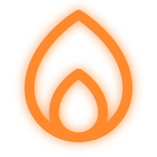

  

# Prakāram

> **A quiet companion for chanting the Vedas, and a studio for your own prakarams.**

Open it at **[prakaram.sushruth.dev](https://prakaram.sushruth.dev)**. It installs as an app and works offline after one visit.

---

## ✨ What it does

### Chant from pages, like a book
* **Pages, not lines:** the verses run on as prose, as on a palm leaf. A phone shows one page, a wide screen two, and the next page peeks in at the edge. Text size and screen size decide where pages break; nothing reflows while you chant.
* **The highlight leads:** the pada you are on is highlighted, and the pages slide on by themselves when it moves past the page.
* **Swaras in colour:** svarita is purple, anudātta blue and dīrgha svarita red.
* **Moving the highlight:** the arrow buttons (at the bottom on a phone, top right on a desktop) or the arrow keys and Space. Tapping the text does nothing, so a stray touch cannot lose your place.
* **Auto and Learn:** turn on Auto to advance at a set pace. With Learn, six taps of Next teach the app your pace (laya), which it measures in mātrās as Chandaḥ-śāstra does.
* **Back to your place:** swipe ahead to look, and an arrow slides you back to the highlight. Each prakaram remembers where you were.
* **Zen mode:** press `Z` or the lotus icon to hide everything but the text.

### Read in your script
Every verse and title follows the script you choose: Devanagari, Telugu, Kannada, Tamil (with South Indian subscript numerals), Malayalam or IAST, all with Vedic swaras.

### The Koshah, a library of sources
* **Browse:** the Koshah at [`#/wiki`](https://prakaram.sushruth.dev/#/wiki) holds the Ṛgveda, the Taittirīya Saṃhitā, Brāhmaṇa and Āraṇyaka, the Śrī Sūkta and the Nārāyaṇa Upaniṣad. Search it, or open a text and **Follow** it.
* **Addresses (nirdeśa):** every pada has a number, and where a text prints verse numbers its ṛks are numbered too. Tap two numbers to follow, copy or add that range.
* **Citations in words:** a passage is cited the traditional way, as in `Taittirīya Saṃhitā · caturtha-kāṇḍa · pañcama-prapāṭhaka`.
* **Terms explain themselves:** hover over or tap a word like ṛk, pāda or kriyā to see its meaning.

### Build a prakaram
* **My prakaram:** add whole texts, sections or single ranges, then reorder and name them in Compose.
* **Kriyās:** each step can carry a name and a `kariṣye` sankalpa line.
* **Share:** a prakaram fits in a link. The link stays on your device and never reaches a server.

### Chant together
Start a parāyaṇam room and share the link. Everyone who opens it follows your lines and pace live, with no account and no server.

### Themes
System, Light and Dark.

---

## 🙏 Sources and credits
The texts in the Koshah come from these editions, and we are grateful to the people who typed and proofread them. Full notices are in [`THIRD_PARTY_NOTICES.md`](THIRD_PARTY_NOTICES.md).

* **Ṛgveda:** [DharmicData](https://github.com/bhavykhatri/DharmicData) by [Bhavy Khatri](https://github.com/bhavykhatri) ([ODbL 1.0](https://opendatacommons.org/licenses/odbl/1-0/)).
* **Ṛgveda with the dīrgha svarita:** [Saswara Rigveda Samhita](https://github.com/daithal/saswara-rigveda) by [Dayananda Aithal](https://github.com/daithal).
* **Taittirīya Saṃhitā, Brāhmaṇa and Āraṇyaka:** [taittiriya.com](https://taittiriya.com/), edited by [Sridhar Iyer](https://taittiriya.com/about) from the edition of Mullaivasal Sri Krishnamurthy Sastrigal.
* **Śrī Sūkta:** [sanskritdocuments.org](https://sanskritdocuments.org/doc_veda/s-sukta-accent.html), encoded by Avinash Sathaye and Anant Upadhyayula.
* **Nārāyaṇa Upaniṣad:** [sanskritdocuments.org](https://sanskritdocuments.org/doc_upanishhat/nArAyaNopaniShat.html), encoded and proofread by Sunder Hattangadi.
* **Namaste astu bhagavan** (chanted after the first anuvāka of the Rudram): [sanskritdocuments.org](https://sanskritdocuments.org/doc_shiva/rudram.html).
* **Icons:** [Phosphor Icons](https://phosphoricons.com) (MIT).

## 📜 License
Everything in the Koshah belongs to the public. Nobody owns an edition, a reading or a prakaram. The Vedic texts are ancient, but a typed and proofread edition can carry rights, so a text whose permission we cannot confirm stays a draft until we replace it with our own from the original. Each text shows its source and licence in the Koshah. The code is released under the MIT License.
